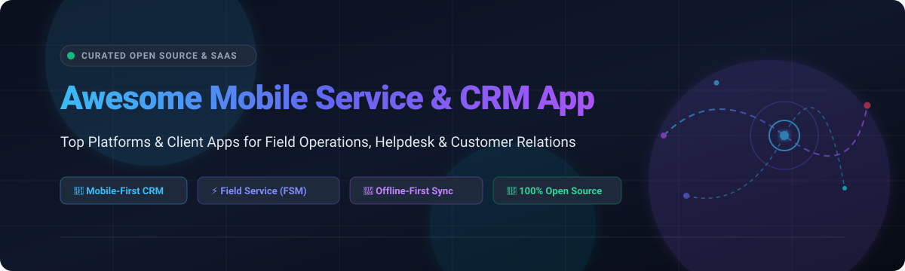

# Awesome Mobile Service & CRM App

  

  
  
  
  
  
  

> 📱 **Awesome Mobile Service & CRM App** is a curated list of top-tier mobile CRM, customer service helpdesk, and field service management (FSM) platforms. Featuring both enterprise cloud SaaS solutions and community-driven, self-hosted open-source apps built with Flutter, React Native, and native mobile technologies.
>
> 🌟 **Star this repository** if you find it helpful for your operations, agency, or mobile app architecture!

---

## 📋 Table of Contents

- [🌐 Sector Overview & Market Dynamics](#-sector-overview--market-dynamics)
- [🟦 SaaS / Hosted Platforms](#-saas--hosted-platforms)
- [🟩 Open-Source Software](#-open-source-software)
  - [1. TwentyMobile](#1-twentymobile-)
  - [2. Chatwoot Mobile](#2-chatwoot-mobile-)
  - [3. FreeScout (PWA)](#3-freescout-pwa-)
  - [4. BottleCRM](#4-bottlecrm-)
  - [5. Flutter CRM](#5-flutter-crm-)
  - [6. Customer Database](#6-customer-database-)
  - [7. ERPNext Field Service Management](#7-erpnext-field-service-management-)
  - [8. CLIVORA](#8-clivora-)
- [📊 Feature Comparison Matrix](#-feature-comparison-matrix)
- [🤝 Contributing Guidelines](#-contributing-guidelines)
- [📈 Star History](#-star-history)
- [☕ Support & Sponsorship](#-support--sponsorship)
- [📄 License](#-license)

---

## 🌐 Sector Overview & Market Dynamics

The global **Mobile CRM** and **Field Service Management (FSM)** sectors are estimated at **~$25B–$30B** and projected to surpass **$60B+** by the early 2030s, compounding at an annual growth rate (~11–12% CAGR). The market structure exhibits a dual dynamic:

- **Enterprise Concentration:** The top tier is dominated by large platform giants (*Salesforce*, *ServiceNow*, *HubSpot*) offering deeply integrated suites spanning customer service, field technician dispatching, omnichannel routing, and AI agents.
- **Mid-Market & SME Fragmentation:** The SME and mid-market spaces remain highly fragmented. Businesses frequently seek lightweight, self-hostable, or offline-first mobile apps (*BottleCRM*, *TwentyMobile*, *Chatwoot*, *FreeScout*) to maintain full data privacy, avoid per-seat subscription lock-in, and empower field workers in intermittent-connectivity environments.

---

## 🟦 SaaS / Hosted Platforms

Enterprise and commercial cloud-hosted mobile CRM and service platforms. Sorted descending by company scale (market capitalization / valuation).

| Platform | Company Valuation / Revenue | Starting Pricing | Free Tier / Trial Limits | Key Mobile Capabilities & Specialization |
| :--- | :--- | :--- | :--- | :--- |
| **Salesforce Mobile** | ~$179B Market Cap (~$38B+ Rev) | $25 / user / month (Starter Suite) | 30-day free trial (up to 10 users, full CRM features, no credit card required) | Full CRM on iOS & Android; offline access, custom objects, push alerts, Lightning Web Components. |
| **ServiceNow Mobile Agent** | ~$106B Market Cap (~$15B+ Rev) | ~$100 / fulfiller user / month (FSM entry tier, custom enterprise contract) | Free developer instance (Personal Developer Instance via developer program; 14-day inactivity timeout); no production free tier | Field service & operations; work orders, dispatching, asset tracking, barcode scanning, offline mode. |
| **HubSpot Mobile CRM** | ~$28B Market Cap (~$3.1B+ Rev) | $15 / seat / month (Starter Customer Platform) or $0 (Free CRM) | Free forever plan (up to 5 users, 1,000,000 contacts, core CRM/ticket tools); 14-day trial for paid tiers | Contact & pipeline management, call logging, email tracking, shared team inbox on mobile. |
| **Zendesk Support Mobile** | ~$10.2B Buyout Valuation (~$2B+ Rev) | $19 / agent / month (Support Team, billed annually) | 14-day free trial (Suite Professional features, up to 5 agents, no credit card required) | Mobile agent workspace; ticket triaging, omnichannel customer context, internal notes, macros. |
| **Pipedrive Mobile** | ~$1.5B Valuation (~$250M+ Rev) | $14 / user / month (Essential, billed annually) | 14-day free trial (full feature access across tiers, no credit card required) | Visual sales pipeline on mobile, deal tracking, mobile caller ID, contact syncing, audio notes. |
| **Intercom Inbox Mobile** | ~$1.3B Valuation (~$250M+ Rev) | $29 / seat / month (Essential tier) | 14-day free trial (full helpdesk & inbox features, no credit card required) | Conversational support inbox; omnichannel messaging, real-time ticket assignment, push notifications. |

---

## 🟩 Open-Source Software

Self-hosted, community-driven mobile customer service, CRM, and field management solutions. Repositories are **sorted descending by star counts** and equipped with direct links to their stargazers page.

### 1. TwentyMobile 
- **Repository:** [twentyhq/twenty](https://github.com/twentyhq/twenty) & [adlucio87/TwentyMobile](https://github.com/adlucio87/TwentyMobile)
- **Stack:** Native iOS / iPadOS / macOS (Swift) | **License:** AGPL-3.0
- **Overview:** TwentyMobile brings the flagship open-source Twenty CRM directly to Apple platforms. Built as an offline-first companion with native UI responsiveness:
  - **Direct Self-Hosted Sync:** Connects directly to your own self-hosted or managed Twenty CRM instance without third-party telemetry.
  - **Dynamic Workspace & Custom Objects:** Full support for custom tables, dynamic field views, and relation mapping.
  - **Camera Business Card Scanner:** On-device OCR extracts contact information, emails, and company names directly into leads without an active internet connection.
  - **Local Reminders:** Smart background alerts notify field agents 30 minutes before task deadlines.
- **Best For:** Teams and solopreneurs utilizing Twenty CRM who require an Apple-native client.

### 2. Chatwoot Mobile 
- **Repository:** [chatwoot/chatwoot](https://github.com/chatwoot/chatwoot) & [chatwoot/chatwoot-mobile-app](https://github.com/chatwoot/chatwoot-mobile-app)
- **Stack:** React Native / Ruby on Rails | **License:** MIT
- **Overview:** The official cross-platform mobile client for Chatwoot, an omnichannel customer service and live-chat platform:
  - **Omnichannel Inbox on Mobile:** Unified inbox spanning live chat, WhatsApp, Twitter/X, Facebook Messenger, SMS, and email.
  - **Push Notifications & SLAs:** Instant push notifications for incoming conversations, priority assignments, and ticket escalations.
  - **Agent Collaboration:** Internal notes, mentions, canned responses, and conversation assignment directly from iOS and Android devices.
- **Best For:** Customer support teams wanting a mature, mobile-first helpdesk app connected to a self-hosted Chatwoot instance.

### 3. FreeScout (PWA) 
- **Repository:** [freescout-help-desk/freescout](https://github.com/freescout-help-desk/freescout)
- **Stack:** PHP / Laravel / MySQL (Progressive Web App) | **License:** AGPL-3.0
- **Overview:** A lightweight, self-hosted helpdesk and shared inbox with a mobile-optimized Progressive Web Application (PWA):
  - **Zero App Store Overhead:** Installable directly from mobile web browsers on iOS and Android with Web Push notification support.
  - **Unlimited Helpdesk:** No per-user or per-mailbox fees; supports shared mailboxes, internal team chats, and collision detection.
  - **Broad Integration Ecosystem:** Connects with WhatsApp, Telegram, Slack, and Microsoft 365 / Google Workspace via OAuth.
- **Best For:** Small-to-medium businesses wanting a lightweight mobile helpdesk without native store app deployment complexities.

### 4. BottleCRM 
- **Repository:** [Django-CRM/Django-CRM](https://github.com/Django-CRM/Django-CRM)
- **Stack:** Django 6 / Django REST Framework / Svelte 5 / Flutter | **License:** MIT
- **Overview:** A multi-tenant, fully featured CRM and support suite equipped with a dedicated Flutter client:
  - **Full Customer Lifecycle:** Leads, contacts, sales pipelines, billing invoices, and complete support ticket management.
  - **Row-Level Security Isolation:** Enforces multi-tenancy at the PostgreSQL layer for enterprise security compliance.
  - **Agent-Ready Architecture:** Ships with comprehensive OpenAPI specifications and personal access tokens for autonomous AI agent integrations.
- **Best For:** Organizations seeking a 100% MIT-licensed, full-scope CRM and helpdesk system with a Flutter companion app.

### 5. Flutter CRM 
- **Repository:** [MicroPyramid/flutter-crm](https://github.com/MicroPyramid/flutter-crm)
- **Stack:** Flutter / Dart / Material Design 3 | **License:** MIT
- **Overview:** A dedicated cross-platform mobile CRM application codebase designed specifically for field agents:
  - **Offline-First Synchronization:** Local database caching allows technicians and reps to view leads and log contacts with zero network connection.
  - **Modular Architecture:** Clean separation of lead tracking, opportunity stages, tasks, call logs, and support cases.
  - **Modern UI:** Material 3 design system supporting dark mode, dynamic layouts, and cross-platform compilation (Android & iOS).
- **Best For:** Developers and businesses looking for an open-source Flutter mobile CRM foundation to customize and rebrand.

### 6. Customer Database 
- **Repository:** [schorschii/CustomerDB-Android](https://github.com/schorschii/CustomerDB-Android)
- **Stack:** Native Android (Java) / MySQL | **License:** GPL-3.0
- **Overview:** A lightweight Android app engineered to keep professional customer records separate from personal address books:
  - **Self-Hosted Database Sync:** Synchronizes directly with a private MySQL server, keeping full ownership of records on-premise.
  - **Caller Identification:** Displays client information on incoming calls when numbers match database entries.
  - **Privacy & GDPR Compliance:** Built-in tools for data export, birthday reminders, VCF import/export, and customer categorization.
- **Best For:** Freelancers and tradespeople who need a simple, self-hosted contact manager on their Android devices.

### 7. ERPNext Field Service Management 
- **Repository:** [Beveren-Software-Inc/Field_Service_Management](https://github.com/Beveren-Software-Inc/Field_Service_Management)
- **Stack:** React 19 / Frappe / ERPNext | **License:** MIT
- **Overview:** An open-source Field Service Management (FSM) module and mobile-ready interface integrated directly with the ERPNext ecosystem:
  - **Field Service Scheduling:** Dispatch boards, technician appointment scheduling, and customer location mapping.
  - **On-Site Execution:** Work order checklists, spare parts consumption, and signature capture for completed service visits.
  - **Unified Accounting:** Directly converts service appointments into invoices within ERPNext.
- **Best For:** Field service operators, HVAC, repair, and maintenance teams already running on ERPNext.

### 8. CLIVORA 
- **Repository:** [UsmanGhias/clivora](https://github.com/UsmanGhias/clivora)
- **Stack:** Flutter / Drift / Supabase PostgreSQL | **License:** GPL-3.0
- **Overview:** An offline-first mobile application designed as an open-source "Freelancer Operating System":
  - **Transactional Outbox Sync:** Local Drift database persists CRM events offline and syncs deterministically with Supabase.
  - **Integrated Business OS:** Unifies contacts, client workspaces, project milestones, invoices, and expense tracking.
  - **Grounded AI Assistance:** In-app AI drafts proposals and project updates grounded in local CRM data.
- **Best For:** Freelancers, creative agencies, and solo consultants needing an offline-first mobile CRM with integrated invoicing.

---

## 📊 Feature Comparison Matrix

| Platform / Tool | Type | License | Primary Tech Stack | Native Mobile App | CRM Scope | Field Operations & Helpdesk | Self-Hostable |
| :--- | :--- | :--- | :--- | :--- | :--- | :--- | :--- |
| **Salesforce Mobile** | SaaS | Commercial | Cloud Native | ✅ iOS / Android | ✅ Enterprise CRM | ✅ Full Service / FSM | ❌ Cloud only |
| **ServiceNow Mobile** | SaaS | Commercial | Cloud Native | ✅ iOS / Android | ⚠️ ITSM / CSM | ✅ Field Service (FSM) | ❌ Cloud only |
| **HubSpot Mobile** | SaaS | Commercial | Cloud Native | ✅ iOS / Android | ✅ Inbound CRM | ⚠️ Support Tickets | ❌ Cloud only |
| **Zendesk Support** | SaaS | Commercial | Cloud Native | ✅ iOS / Android | ⚠️ Service CRM | ✅ Omnichannel Desk | ❌ Cloud only |
| **Pipedrive Mobile** | SaaS | Commercial | Cloud Native | ✅ iOS / Android | ✅ Sales CRM | ❌ Pipeline focus | ❌ Cloud only |
| **Intercom Inbox** | SaaS | Commercial | Cloud Native | ✅ iOS / Android | ⚠️ Chat CRM | ✅ Live Conversations | ❌ Cloud only |
| **TwentyMobile** | Open Source | AGPL-3.0 | Native iOS / Swift | ✅ Apple Platforms | ✅ Full Modern CRM | ⚠️ Tasks & Agenda | ✅ Self-hosted |
| **Chatwoot Mobile** | Open Source | MIT | React Native | ✅ iOS / Android | ⚠️ Omnichannel Desk | ✅ Live Support Chat | ✅ Self-hosted |
| **FreeScout (PWA)** | Open Source | AGPL-3.0 | PHP / Laravel | 📱 PWA (Mobile Web) | ⚠️ Helpdesk CRM | ✅ Shared Inbox | ✅ Self-hosted |
| **BottleCRM** | Open Source | MIT | Django / Flutter | ✅ Flutter | ✅ Full CRM Suite | ✅ Integrated Helpdesk | ✅ Self-hosted |
| **Flutter CRM** | Open Source | MIT | Flutter / Dart | ✅ iOS / Android | ✅ Lead Management | ⚠️ Offline Tasks | ✅ Self-hosted |
| **Customer Database** | Open Source | GPL-3.0 | Native Android (Java) | ✅ Android Native | ⚠️ Contact DB | ❌ Contacts / Calls | ✅ Self-hosted |
| **ERPNext FSM** | Open Source | MIT | React / ERPNext | 📱 Mobile-Ready | ✅ Full ERP / CRM | ✅ Work Orders & FSM | ✅ Self-hosted |
| **CLIVORA** | Open Source | GPL-3.0 | Flutter / Supabase | ✅ iOS / Android | ✅ Freelancer CRM | ⚠️ Milestones & Tasks | ✅ Self-hosted |

---

## 🤝 Contributing Guidelines

Contributions are warmly welcomed! If you are developing or using an open-source mobile service, field operations, or CRM project that should be featured:

1. **Fork** the repository and create your feature branch: `git checkout -b feature/new-crm-tool`.
2. Ensure the tool is **actively maintained** and provides a genuine mobile experience (Native, Flutter, React Native, or PWA).
3. Update the README with the project's repository, stack, star badge, and feature summary.
4. Submit a **Pull Request** with a descriptive summary of your additions.

---

## 📈 Star History

---

## ☕ Support & Sponsorship

If this curated collection helps you find the right mobile CRM or field service solution for your business or technical stack, please consider supporting the project:

- 🌟 **Star this repository** to help others discover it on GitHub.
- 🍴 **Fork and share** the repo with your network and team.
- ☕ **Buy me a coffee & become a sponsor:** Support ongoing open-source maintenance and research directly via the [GitHub Sponsor Dashboard](https://github.com/sponsors/ishandutta2007).

Thank you for being part of the open-source community! 🚀

---

## 📄 License

This collection is released under the [CC0 1.0 Universal](LICENSE) (Public Domain Dedication). All linked software projects and trademarks remain property of their respective creators and maintainers.
